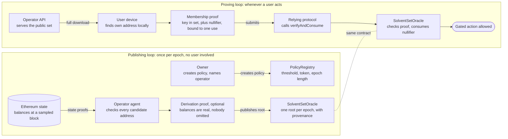

# ZK Proof of Funds

Prove that you control a wallet that met a balance threshold, without
revealing which wallet.

> **Status: protocol simulation.** The protocol is implemented and its known
> soundness bugs are fixed, but no proof has yet been verified by a Solidity
> contract on a real EVM. See [STATUS.md](STATUS.md) before relying on
> anything here.

## What it proves

A *threshold-balance attestation*:

> The prover controls the signing key of an externally-owned account whose
> address was in a committed set of addresses that met a balance threshold at
> one or more historical sampled blocks.

It does **not** prove beneficial ownership, absence of liabilities, that the
funds were not borrowed, or that the balance still exists. Smart-contract
accounts (Safe, ERC-4337, passkeys) are unsupported. A streak of N means the
threshold was met at N sampled observations, one per epoch, not held
continuously.

## How it works

The current design (Privacy V2, the *solvent-set* model) splits the work into
two loops that only meet at the published root. The operator never hears from
the user, which is what keeps the user's address private.



**Publishing loop.** Each epoch the operator's agent checks a list of
*candidate* addresses against the chain state at a reference block. The block
is sampled from entropy that is unknown until the epoch window closes, so the
operator cannot choose it. Candidates that meet the threshold form the
*solvent set*; its Merkle root is published on-chain.

**Proving loop.** A user downloads the whole public set, finds their own
address locally, and generates a zero-knowledge proof that they hold the key
to some address in it. The proof carries a deterministic nullifier
([ERC-7524](https://eips.ethereum.org/EIPS/eip-7524) / PLUME) so the same key
cannot act twice, and is bound to one verifier, action, beneficiary, nonce and
deadline so it cannot be replayed or front-run.

An older *monitored* model (V1: enroll once, the operator watches your address
and serves Merkle proofs) still coexists per policy. See
[ARCHITECTURE.md](ARCHITECTURE.md).

## Who does what

| Actor | What they are | What they do | What they are trusted for |
|---|---|---|---|
| **Owner** | The account that deployed the contracts | Creates policies, sets verification keys, can pause publication or revoke a root | Setting honest rules. Policies freeze on first publication, so a published root's meaning cannot be rewritten |
| **Operator** | Whoever runs the off-chain agent for a policy | Derives the solvent set each epoch and publishes its root | Depends on the root's provenance level (below) |
| **User** | The wallet holder, acting as prover | Generates a membership proof locally with `zkpof-client` | Nothing. The claim is checked cryptographically |
| **Integrator** | A relying protocol (lending pool, governance vote, airdrop) | Its contract calls `SolventSetOracle.verifyAndConsume` before allowing an action | Nothing beyond choosing the policy and minimum streak |

Every published root records one of three provenance levels:

| Provenance | What is proven | What you still trust the operator for |
|---|---|---|
| `OperatorAsserted` | Nothing | Everything about the set |
| `BalancesProven` | Every address in the set met the threshold | Not leaving qualifying addresses out |
| `RangeScanProven` | Also that the candidate list covers every address seen in a recorded block range | Only the choice of range |

## What each party learns

| Party | Learns the user's address or public key? | What it does see |
|---|---|---|
| Operator | No | That someone downloaded the public set |
| Relying protocol and oracle | No | The proof, the nullifier hash, and the presentation context |
| Chain observers | No | The same as the relying protocol |

Caveats a user must know about are in
[PRIVACY_V2.md §4.6](PRIVACY_V2.md#46-what-leaks-and-what-does-not): the
submitting address, delegated proving, nullifier reuse within a scope, and
small sets.

## Quick start

```bash
cargo test --workspace                 # Rust: common, agent, differential fuzz
cd contracts && forge test             # Solidity, incl. the mutation matrix
cd sdk && npx vitest run               # SDK, incl. cross-language vectors
cd web && npx tsc --noEmit && npm run build

bash scripts/real-proof-e2e.sh         # full proof pipeline, degrades by platform
```

Running the agent, contracts and front end locally is covered step by step in
[USER_GUIDE.md](USER_GUIDE.md#running-locally).

## Repository layout

| Path | Contents |
|---|---|
| `crates/common` | Shared statements: Merkle-Patricia verification, PLUME nullifiers, set derivation, receipt scan |
| `crates/agent` | The operator agent (scheduler, RPC fetcher, provers, chain publisher) and the `zkpof-client` / `zkpof-e2e` binaries |
| `crates/backend` | The agent's HTTP API |
| `program-solvent-set`, `program-membership`, `program-receipt-scan` | SP1 guest programs for V2 |
| `program` | SP1 guest program for the V1 batch model |
| `contracts` | `SolventSetOracle`, `SolvencyRootOracle`, `PolicyRegistry`, `RelyingProtocol` |
| `sdk`, `web`, `examples` | TypeScript SDK, React front end, example integrations |

## Documentation map

| Document | Read it when |
|---|---|
| [STATUS.md](STATUS.md) | You want to know what works, what does not, and what is next |
| [PRIVACY_V2.md](PRIVACY_V2.md) | You need the normative V2 spec: nullifiers, the solvent-set model, byte layouts |
| [docs/PERFORMANCE.md](docs/PERFORMANCE.md) | You want sizes, proving cost, and how each step scales |
| [USER_GUIDE.md](USER_GUIDE.md) | You are running, operating, or integrating the system |
| [ARCHITECTURE.md](ARCHITECTURE.md) | You need the V1 monitored model |
| [EXECUTION_PLAN.md](EXECUTION_PLAN.md) | You want phase-by-phase history and the roadmap |
